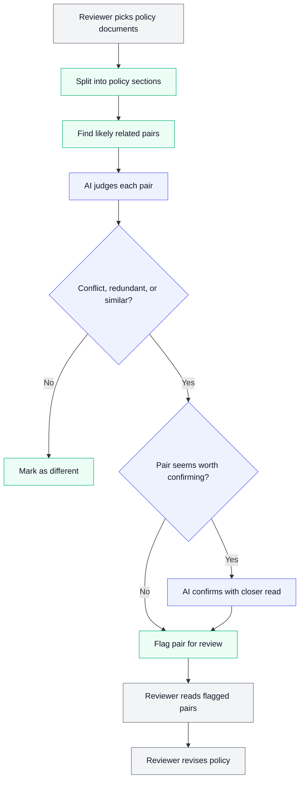
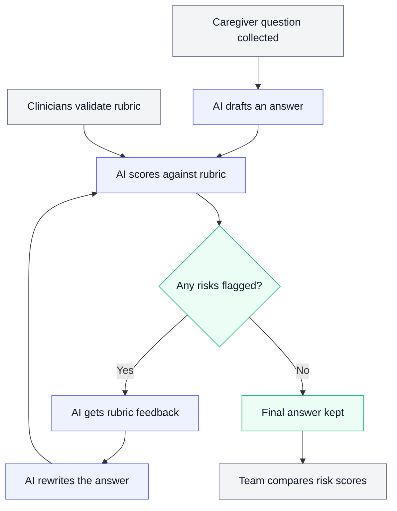
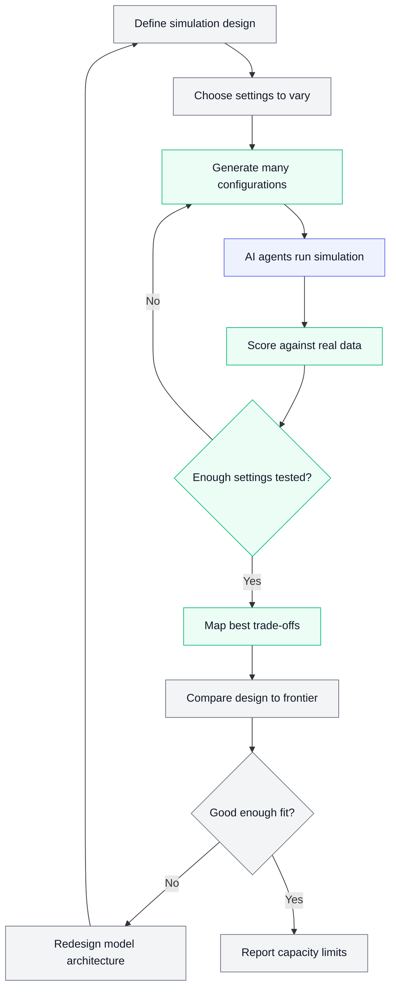

# AI Pulse — Week of 2026-10-22

*29 items this week.*

## Featured this week

*Diagram key: grey = person · purple = AI · green = tool or data*

### [Policy Central: Detecting Conflicts, Redundancy, and Similarity in Deployed Police Policy](https://arxiv.org/abs/2610.29338)
*arXiv: Computers and Society (cs.CY) · Level: Workflow · Field: Criminal Justice*

Policy Central is a tool already in use that helps police departments spot when sections of their written policies contradict each other, repeat each other, or are just similar. The researchers tested two designs on real policy documents and found AI judges a pair of sections well, but finding which pairs to compare is much harder.

**Before:** Staff had to read an entire policy library, nearly 20,000 sections, and mentally check each section against the others to catch contradictions or repeated rules. In practice this is so slow that many conflicts likely went unnoticed.

**After:** Policy Central breaks policies into sections, uses a search step to pick likely related pairs, and has an AI label each pair as conflicting, redundant, similar, or different. One design runs cheaply across the whole library, while another does a deeper, exhaustive check on documents a reviewer chooses.

**Why it matters:** It shows AI can help clean up large policy libraries, but the real bottleneck is finding the problem pairs, so reviewers still shouldn't assume the tool catches every conflict.

### [RubRIX: Rubric-Driven Risk Mitigation in Caregiver-AI Interactions](https://arxiv.org/abs/2601.13235)
*arXiv: Computers and Society (cs.CY) · Level: Workflow · Field: Research*

Researchers created RubRIX, a scoring checklist (a rubric) built with clinicians to spot risks in AI answers to caregivers, such as ignoring their distress, showing bias, giving wrong information, agreeing uncritically, or sounding overly certain. They tested six leading AI models on over 20,000 real caregiver questions and found that using the rubric to guide revisions cut the risk components by 45-98%.

**Before:** AI answers to caregivers were usually checked with general safety tests for things like toxicity or made-up facts, or reviewed by hand. Those checks can miss subtler problems, such as ignoring a caregiver's distress or sounding overly certain.

**After:** A clinician-validated rubric scores each AI answer on five caregiving-specific risks, and the AI uses that feedback to revise its draft. Tested on over 20,000 real caregiver questions across six leading models, this cut risk components by 45-98%.

**Why it matters:** It shows how to build a field-specific, expert-validated checklist to evaluate and improve AI answers in sensitive human-service settings where generic safety tests miss important harms.

### [Model Capacity Frontier: A Development Framework for LLM-Supported Social Simulation](https://arxiv.org/abs/2610.24168)
*arXiv: Computers and Society (cs.CY) · Level: Agent · Field: Research*

Researchers are using AI chatbots-like agents to play the role of people in computer simulations of group behavior, but small choices like how the AI is prompted can change the results a lot. This paper proposes the Model Capacity Frontier, a method that systematically tests many setups to find the best performance a given simulation design can realistically reach.

**Before:** Researchers building simulations with AI agents usually tried a handful of prompts and settings by hand, then reported whichever version looked most realistic. Because small choices like wording can change results a lot, it was hard to tell whether a weak result meant a bad setup or a real limit of the approach.

**After:** The Model Capacity Frontier method systematically tries many combinations of settings, scores each against real-world data, and maps the best results it can reach (the trade-off curve, or Pareto frontier, when there are several goals). This shows how good a given simulation design can realistically get, so researchers can tell a poor setup from a design that has hit its ceiling.

**Why it matters:** It gives policy and social science researchers a more disciplined way to judge whether an AI-powered simulation of human behavior is trustworthy or just reflects arbitrary setup choices.

## New capabilities

### [Donating Agent Skills to the Agentic AI Foundation](https://www.anthropic.com/news/donating-agent-skills-to-the-agentic-ai-foundation)
*Anthropic News · Level: Agent · Field: General*

Anthropic is donating Agent Skills, an open standard that gives AI agents specialized knowledge and step-by-step workflows, to the Agentic AI Foundation. More than 70 agent platforms, including ChatGPT, Cursor, GitHub Copilot, and VS Code, have adopted it since it was published in December 2025.

**Why it matters:** A shared standard means a skill you set up once, like a way of summarizing policy documents, could work across many different AI tools instead of being locked into one.

**Analogy:** It's like a universal recipe card format: any kitchen (AI tool) can read the same card and cook the dish the same way, instead of each kitchen needing its own custom version.

### [Building agents: When to fold subagents into your main agent loop](https://claude.com/resources/articles/building-agents-when-to-fold-subagents-into-your-main-agent-loop)
*Claude Blog · Level: Agent · Field: General*

This Claude Blog post explains that when building AI agents, it is often better to use fewer helper agents (called subagents) and instead give one main agent information and tools gradually, only when it needs them. Doing this can improve the quality of results while lowering cost and waiting time, and the post covers when and how to make the switch.

**Why it matters:** If your team ever commissions or uses AI agents for research or policy tasks, this shows that a simpler single-agent setup can be cheaper, faster, and more reliable than a complicated team of agents.

**Analogy:** It's like one skilled analyst who pulls out the right reference binder only when a question needs it, instead of hiring a team of specialists who must constantly brief each other.

### [Claude Security now scans continuously and tracks fixes](https://claude.com/resources/articles/claude-security-now-scans-continuously-and-tracks-fixes)
*Claude Blog · Level: Agent · Field: General*

Claude Security, a tool that checks software code for security problems, now keeps scanning a team's code as it changes instead of running one-time checks. It also tracks each problem it finds until it is fixed, learns from notes your team adds, and connects to other tools through an API and MCP, and it is in public beta for Claude Enterprise customers.

**Why it matters:** It shows AI moving from one-off checks to ongoing monitoring that follows issues through to resolution, a pattern that could carry over to other kinds of review work, even though this tool itself is aimed at software teams.

**Analogy:** It is like swapping an annual building inspection for a security guard who walks the halls every day, keeps a log of each problem spotted, and checks back until the repair is done.

### [Introducing Claude Duet](https://claude.com/resources/articles/claude-duet)
*Claude Blog · Level: — · Field: General*

Anthropic, the company that makes Claude, has announced something called Claude Duet and is releasing it as an early test version. Access is through a waitlist, starting with US subscribers on the Pro and Max plans, and the short description doesn't say what Duet actually does.

**Why it matters:** It signals a new Claude feature or product worth watching, but you'll need the full announcement to know whether it changes how research, policy, or communications teams can work.

**Analogy:** It's like a restaurant's soft opening for invited guests: the doors are open to a small group first, so the owners can see how it goes before opening to everyone.

### [Redesigning source control at Anthropic](https://www.anthropic.com/engineering/redesigning-source-control)
*Claude Blog · Level: Agent · Field: General*

Anthropic's daily code changes jumped from about 2,500 to more than 30,000, which made the system for tracking and combining those changes its biggest slowdown. The team built its own replacement called Scion, designed for AI agents that are always connected, and moved off the widely used tool git in five months.

**Why it matters:** It shows that AI agents are producing so much work that the basic tools people use to track and combine changes have to be rebuilt around them.

**Analogy:** Imagine a shared Google Doc built for a handful of editors suddenly having thousands of tireless editors working at once; the old way of saving and merging everyone's changes would jam up, so you'd design a new system built for that crowd from the start.

### [How the Claude Code team does code review](https://claude.dev/blog/solving-code-review-at-anthropic/)
*Claude Blog · Level: Agent · Field: General*

The Claude Code team describes how it reviews the large amount of code that AI agents now write, including having Claude check its own work and sending riskier changes to people for approval. The post also offers a checklist other teams can use to set up a similar process.

**Why it matters:** Any team that uses AI to produce work at scale, including research or policy drafts, can borrow this idea of letting AI self-check while matching the level of human review to how risky the output is.

**Analogy:** It is like a newsroom where reporters fact-check their own stories first, then routine pieces go to a quick edit while sensitive investigations need sign-off from a senior editor.

### [How an Anthropic BDR in Japan runs his day with Claude Managed Agents](https://claude.com/resources/articles/how-an-anthropic-japan-business-development-representative-runs-his-day)
*Claude Blog · Level: Agent · Field: Communications*

A business development representative at Anthropic in Japan uses Claude Managed Agents to work through his incoming messages and draft customer emails in both Japanese and English. He also uses a tool called Claude Tag as part of his daily routine.

**Why it matters:** It shows how a non-engineer can hand routine, repetitive communication work to an AI agent, a pattern that communications and outreach teams could borrow.

**Analogy:** It's like having a capable assistant who sorts your inbox each morning and leaves bilingual draft replies ready for you to review and send.

### [Beyond tree cover: mapping the world’s forest types](https://deepmind.google/blog/beyond-tree-cover-mapping-the-worlds-forest-types/)
*Google DeepMind · Level: — · Field: Policy*

Google DeepMind created a global map that labels every 10-meter patch of land on Earth by forest type, going beyond simply showing where trees are. This gives a much more detailed picture of what kinds of forests exist and where.

**Why it matters:** Detailed, consistent data on forest types could help policy and research teams track environmental change and design better land-use and conservation rules.

**Analogy:** It's like upgrading from a map that only shows where green areas are to one that tells you whether each green patch is a rainforest, a pine plantation, or a regrowing woodland.

## What experts are building

### [What FDE means at OpenAI](https://openai.com/index/forward-deployed-engineering-means)
*OpenAI Engineering · Level: — · Field: General*

This OpenAI Engineering post explains what "forward deployed engineering" (FDE) means at the company. In general, the term refers to engineers who work directly with customers to fit technology to their real-world needs, though the item itself gives only a short description.

**Why it matters:** It offers a glimpse of how AI organizations help customers put their tools to practical use, which is useful context if your team ever works with an AI vendor.

**Analogy:** Think of a chef who leaves the test kitchen to cook alongside a restaurant's staff, adjusting the recipe to their ingredients, equipment, and customers.

### [How we built ChatGPT’s novel ad stack for user trust and relevance](https://openai.com/index/building-chatgpt-ad-stack)
*OpenAI Engineering · Level: — · Field: Communications*

OpenAI describes how it built the system that shows ads inside ChatGPT. The system uses a large language model to work out what a user is trying to do in a conversation, keeps ads visibly separate from ChatGPT's answers, and matches relevant ads at large scale.

**Why it matters:** It shows how a major AI company plans to fund chatbots with ads while trying to protect user trust, which raises questions about transparency, influence, and privacy that policy and communications teams will need to watch.

**Analogy:** It works like a newspaper that keeps ads in clearly marked boxes apart from its articles, with a sorter who reads the conversation to pick which ad box fits.

### [How To Use Decision Models for Evals](https://hamel.dev/blog/posts/decision-model-evals/)
*Hamel Husain · Level: Workflow · Field: Research*

Hamel Husain explains that a new wave of small, fast 'decision models' (from companies like Perplexity, Cloudflare, and OpenAI) can sort AI outputs into categories like pass/fail cheaply, making them an alternative to using a large AI as a judge. He points out that many people leave the default cutoff (threshold) of 0.50 unchanged, and shows how tuning it can noticeably improve results.

**Why it matters:** If your team checks the quality of AI-generated summaries or classifications, tuning a simple cutoff setting could make cheap automated checks much more accurate.

**Analogy:** It's like a smoke detector: the default sensitivity might go off every time you make toast or miss a real fire, so you adjust the sensitivity to fit your kitchen.

## Research and policy teams

### [30 Months on the Exponential (in Charts)](https://www.oneusefulthing.org/p/30-months-on-the-exponential-in-charts)
*One Useful Thing · Level: — · Field: General*

Ethan Mollick announces that his new book is out today and looks back at what has changed in AI since his previous book. The title suggests he uses charts to show about 30 months of rapid, accelerating progress.

**Why it matters:** A big-picture view of how fast AI has improved can help you judge which tasks in research, policy, and communications are worth rethinking now.

**Analogy:** It's like the pencil marks on a doorframe that track a child's height each year: looking at the marks together shows how much growth happened, and how quickly, in a way a single day never could.

### [The Privacy Paradox Is a Misnomer: Data Under Structural Uncertainty](https://arxiv.org/abs/2610.29756)
*arXiv: Computers and Society (cs.CY) · Level: — · Field: Policy*

The 'privacy paradox' is the idea that people say they care about privacy but still readily share personal information. An online field experiment finds this isn't truly contradictory: people's choices are driven by uncertainty about how risky sharing actually is, not by giving in to temptation.

**Why it matters:** For policy researchers, this suggests privacy rules and consent designs should focus on making risks clearer rather than assuming people are irrational or don't really care.

**Analogy:** It's like someone who cares about their health but skips a checkup because they can't tell how likely a problem is or how bad it would be; the choice reflects fuzzy information, not hypocrisy.

### [Privacy Preference Controls for Agentic Systems](https://arxiv.org/abs/2610.29929)
*arXiv: Computers and Society (cs.CY) · Level: Agent · Field: Policy*

This paper asks what privacy controls should look like when AI agents act on a person's behalf online, instead of the person clicking around themselves. The authors build a taxonomy (a organized list) of privacy preferences that could actually be enforced, drawing on privacy laws, studies of existing privacy tools, and an audit of 30 leading AI assistants and agent platforms.

**Why it matters:** As AI agents start browsing, buying, and sharing data for people, today's privacy tools and laws built for human-driven web use may not protect users, so policy and research teams need new frameworks for giving people real control.

**Analogy:** It's like the difference between giving instructions to a personal assistant about what private information they may share and with whom, versus only having a 'do not disturb' sign on your own front door.

### [AI Security Literacy: Ecosystem-based Competency Framework and K-12 Learning Platform](https://arxiv.org/abs/2610.28859)
*arXiv: Computers and Society (cs.CY) · Level: — · Field: Policy*

This paper proposes a six-part framework for teaching 'AI security literacy' in K-12 schools, meaning the skills students, teachers, and administrators need to use AI safely and spot its risks. It backs the framework with survey data showing only 34.5% of teachers report a school AI policy, and with tests showing that an AI system's reported robustness depends heavily on the specific attack and trained model used.

**Why it matters:** It shows a clear gap between how fast schools are adopting AI and the policies and training in place, which is useful evidence for anyone researching or shaping education and technology policy.

**Analogy:** It's like a school adding fire-safety training after installing new equipment: the tools arrived first, and now people need to learn the risks, the rules, and what to do when something goes wrong.

### [How to Stop Playing Whack-a-Mole: Mapping the Ecosystem of Technologies Facilitating AI-Generated Non-Consensual Intimate Images](https://arxiv.org/abs/2602.04759)
*arXiv: Computers and Society (cs.CY) · Level: — · Field: Policy*

This paper maps out the many kinds of technology that make it possible to create, share, spread, and find AI-generated fake intimate images made without a person's consent, sorting them into 11 categories. It argues that current efforts to fight this abuse are scattered and reactive, like whack-a-mole, because they lack a shared big-picture view of how these technologies connect.

**Why it matters:** A shared map of the whole technology ecosystem could help policymakers, platforms, and advocates coordinate and compare interventions against image-based sexual abuse, which harms women and girls most.

**Analogy:** Think of it like mapping an entire supply chain for a harmful product, from raw materials to stores to advertising, so you can see where to intervene instead of shutting down one shop at a time while others pop up.

### [When Is Disclosing Private Conversations with AI to the State Justified? Proactive Referral Policies of Major U.S. AI Companies through the Lens of Contextual Integrity](https://arxiv.org/abs/2610.25169)
*arXiv: Computers and Society (cs.CY) · Level: — · Field: Criminal Justice*

AI companies sometimes tell police about user chats they think are dangerous, even when the government hasn't asked. This study builds eight criteria for when that is justified, using a privacy theory called contextual integrity, and checks 27 public documents from six major U.S. AI companies against them; the excerpt shows no company clarified whether broad sharing provisions or narrower safety rules govern these referrals.

**Why it matters:** People increasingly confide sensitive thoughts to AI, so unclear referral rules could expose them to criminal investigation or leave real threats unaddressed, which makes this a key issue for privacy and criminal justice policy.

**Analogy:** It's like asking when a therapist may break confidentiality to warn police: there should be clear, known rules, and AI chatbots currently have far vaguer ones than counselors do.

### [Knowledge-Certainty Diversity Predicts Human-Human and Human-AI Open-Ended Discussion Synergy and Reveals Pure-AI Discussion Shortfalls](https://arxiv.org/abs/2507.22889)
*arXiv: Computers and Society (cs.CY) · Level: — · Field: Research*

Researchers tested whether AI chatbots get smarter by talking things over the way people do, using medical multiple-choice questions before and after a discussion. Groups that included humans got more accurate (even the weaker members improved), but groups made up only of AI models didn't improve and often got worse.

**Why it matters:** It suggests that setups where AI models simply chat with each other may not improve answers, so keeping a human in the loop could matter for research and policy work that relies on AI discussion or review.

**Analogy:** It's like a study group: when people with different knowledge and different levels of confidence talk, everyone learns something, but if everyone in the room shares the same blind spots and sounds equally sure, the chat just reinforces mistakes.

### [Ozone: A Unified Platform for Transportation Research](https://arxiv.org/abs/2604.10959)
*arXiv: Computers and Society (cs.CY) · Level: — · Field: Research*

Ozone is a shared research platform that pulls transportation data from cameras, drones, LiDAR, and in-vehicle sensors into one common format, so studies can be compared and repeated more easily. It currently links 19 trajectory datasets from 59 sites in eight countries, with converters finished for 12 and underway for seven.

**Why it matters:** Standardizing messy datasets and safety measures makes traffic safety findings easier to reproduce and compare, which supports more reliable evidence for transportation policy.

**Analogy:** It works like a universal power adapter for traffic data: many different plugs from different countries and devices all get converted to one standard socket, so the same tools can run on all of them.

## Research worth knowing

### [How Claude designed protein binders against scorpion neurotoxins](https://www.anthropic.com/research/claude-scorpion-toxin-binder-design)
*Anthropic Research · Level: — · Field: Research*

Anthropic asked an internal research version of Claude to design minibinders, which are small proteins that attach tightly to a target, against scorpion neurotoxins. The work tests whether an AI model can take on a real protein design problem in biology.

**Why it matters:** It shows AI moving from answering questions to contributing to hands-on scientific design work, which matters for research teams and for policymakers thinking about both the benefits and the risks.

**Analogy:** It's like asking a skilled locksmith to cut a key that fits a very specific lock, except the lock is a toxin molecule and the key is a tiny protein designed to grip it.

### [Working at the frontier shapes expectations for the future](https://www.anthropic.com/research/expectations-for-the-future)
*Anthropic Research · Level: — · Field: Policy*

Anthropic published two reports: one on how AI is changing jobs inside the company itself, and one comparing what the general public expects AI to do to work and the economy with what Anthropic's own employees expect. The comparison shows a gap between people working closest to the technology and everyone else.

**Why it matters:** Knowing how expectations differ between AI insiders and the public helps policy and research teams judge whose forecasts about jobs and the economy to trust and how to design surveys and messaging around that gap.

**Analogy:** It's like comparing what chefs and diners each expect a new kitchen machine to do: the people working next to it every day may predict very different changes than people who only hear about it.

### [How employment is changing at Anthropic](https://www.anthropic.com/research/employment-at-anthropic)
*Anthropic Research · Level: — · Field: Policy*

Anthropic looked at how AI has changed the way work is organized and who gets hired inside its own company. Because Anthropic is at the leading edge of using AI, its experience may preview how other workplaces will change.

**Why it matters:** It offers an early look at how AI could reshape jobs, hiring, and demand for workers, which is central to labor and economic policy questions.

**Analogy:** It's like studying the first town to get electricity to guess how factories and jobs will change everywhere else.

### [Claude reveals ECDSA curve origins](https://www.anthropic.com/research/ecdsa-curve-origins)
*Anthropic Research · Level: — · Field: Research*

Anthropic reports that Claude helped explain where ECDSA, one of the most widely used cryptographic standards, came from, a mystery that had gone unsolved for decades. The short description does not say how Claude was used to get there.

**Why it matters:** It shows AI being used to dig into long-standing research puzzles, including questions about how the standards we rely on for digital security were originally chosen.

**Analogy:** It's like finally learning who wrote the recipe for a famous dish that restaurants everywhere have used for decades, without anyone knowing how it was first created.

### [Designing more efficient quantum circuits with Claude](https://www.anthropic.com/research/designing-efficient-quantum-circuits)
*Anthropic Research · Level: Agent · Field: Research*

Anthropic researchers gave Claude plain-language descriptions of eight quantum circuits plus an automated scorer that checked each design. Working mostly on its own, Claude produced circuits that beat the best published designs, sometimes by 10 times or more.

**Why it matters:** It shows AI can work through a design problem by proposing, testing, and refining ideas against a scoring tool, a pattern that could carry over to research tasks that have clear ways to check results.

**Analogy:** It's like a student who drafts an answer, gets it graded by an automatic answer key, and keeps revising until the score beats the best published solution.

### [The AI expectations gap](https://www.anthropic.com/research/ai-expectations-gap)
*Anthropic Research · Level: — · Field: Policy*

Anthropic Research shares new survey evidence on how people expect AI to reshape the economy in the coming years. It looks at where the disagreement about AI's future economic impact comes from.

**Why it matters:** Understanding why experts and the public disagree about AI's economic effects helps policy researchers judge forecasts and plan for different possible futures.

**Analogy:** It's like polling weather forecasters to see why some predict a storm and others predict sun, then tracing the disagreement back to the different assumptions behind each forecast.

### [Import AI 477: In which I tell the IMF the Singularity has begun](https://importai.substack.com/p/import-ai-477-in-which-i-tell-the)
*Import AI · Level: — · Field: Policy*

This is an issue of the Import AI newsletter in which the author says he told the IMF (International Monetary Fund) that the "Singularity" has begun. The Singularity is the idea that AI progress could speed up so much that it changes society in huge, hard-to-predict ways. The item gives only the title and a short prompt ("What do you think?"), so the details of his argument are not available here.

**Why it matters:** It suggests AI developers are now making bold claims about AI's pace directly to economic and policy institutions, which could shape how policymakers think about planning for AI.

**Analogy:** It's like a weather forecaster telling a city's emergency planners that a major storm has already started to form, so they should start preparing now rather than waiting to be sure.

## In Practice

*Add your own experiments or interviews here.*

## Guide updates

- **Workflow:** When the AI judges well but the hard part is deciding which items to look at, a fixed workflow with a search step and a confirmation step helps, but the weak link (finding the right pairs) needs the most design attention, not just a better prompt. ([Policy Central: Detecting Conflicts, Redundancy, and Similarity in Deployed Police Policy](https://arxiv.org/abs/2610.29338))
- **Workflow:** When quality depends on a clear, repeatable standard, a workflow that drafts, scores against a rubric, and revises beats a single prompt, and it doesn't need a fully independent agent. ([RubRIX: Rubric-Driven Risk Mitigation in Caregiver-AI Interactions](https://arxiv.org/abs/2601.13235))
- **Agent:** When results hinge on many small setup choices, a single prompt is too fragile, so a repeatable workflow that tests settings systematically and checks them against real data is the better way to judge what the AI can actually do. ([Model Capacity Frontier: A Development Framework for LLM-Supported Social Simulation](https://arxiv.org/abs/2610.24168))
